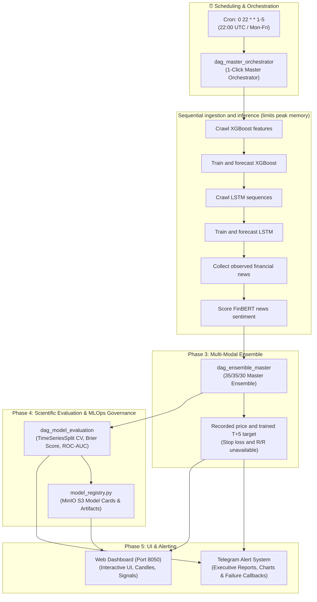

# 🚀 Quantum Multi-Modal Stock Forecasting & MLOps Platform

[](https://github.com/lehoang0702/airflow-stock/actions/workflows/ci.yml)
[](https://airflow.apache.org/)
[](https://min.io/)
[](https://optuna.org/)
[](https://www.python.org/)

An end-to-end Quantitative Multi-Modal Stock Forecasting and MLOps Platform built on **Apache Airflow**, **MinIO S3**, **PostgreSQL**, and **Docker Compose**.

The platform automatically analyzes **20 leading US Blue-chip stocks (S&P 500)** across 3 independent pipelines: **GBDT Machine Learning (XGBoost)**, **Deep Learning Time-Series (PyTorch LSTM)**, and **Financial Language Modeling (FinBERT NLP)**, with separate recorded outputs and a **35/35/30 weighted Master Ensemble**. FinBERT provides positive, negative and neutral news sentiment to the dashboard and Ensemble; it does not issue a standalone price forecast. Missing artifacts remain unavailable; these research models have not established stable performance above a baseline.

---

## 🏗️ System Architecture



---

## 📊 20 Blue-Chip Stock Universe by Sector (GICS Standard)

| # | Ticker | Company Name | GICS Sector |
|---|---|---|---|
| 1 | **AAPL** | Apple Inc. | Information Technology |
| 2 | **MSFT** | Microsoft Corp. | Information Technology |
| 3 | **NVDA** | NVIDIA Corp. | Information Technology |
| 4 | **GOOGL** | Alphabet Inc. | Communication Services / Technology |
| 5 | **AMZN** | Amazon.com Inc. | Consumer Discretionary |
| 6 | **MCD** | McDonald's Corp. | Consumer Discretionary |
| 7 | **NKE** | Nike Inc. | Consumer Discretionary |
| 8 | **WMT** | Walmart Inc. | Consumer Staples |
| 9 | **PG** | Procter & Gamble Co. | Consumer Staples |
| 10 | **KO** | Coca-Cola Co. | Consumer Staples |
| 11 | **JPM** | JPMorgan Chase & Co. | Financials |
| 12 | **V** | Visa Inc. | Financials |
| 13 | **UNH** | UnitedHealth Group | Healthcare |
| 14 | **JNJ** | Johnson & Johnson | Healthcare |
| 15 | **CAT** | Caterpillar Inc. | Industrials |
| 16 | **BA** | Boeing Co. | Industrials (Aerospace & Defense) |
| 17 | **XOM** | Exxon Mobil Corp. | Energy |
| 18 | **CVX** | Chevron Corp. | Energy |
| 19 | **NEE** | NextEra Energy Inc. | Utilities |
| 20 | **LIN** | Linde plc | Materials |

---

## ⚡ Service Ports & Default Credentials

| Service | Port | URL | Default Credentials |
|---|---|---|---|
| **Airflow Web UI** | `8081` | http://localhost:8081 | `admin` / `admin` |
| **Interactive Dashboard** | `8050` | http://localhost:8050 | *(Public access, no authentication required)* |
| **MLflow Tracking UI** | `5000` | http://localhost:5000 | *(Public access, no authentication required)* |
| **MinIO Web Console** | `9001` | http://localhost:9001 | `minioadmin` / `minioadmin` |
| **MinIO S3 API** | `9000` | http://localhost:9000 | `minioadmin` / `minioadmin` |
| **PostgreSQL** | `5433` | `localhost:5433` | `airflow` / `airflow` (db: `airflow`) |

---

## ⏰ Automated Cron Schedule

The pipeline is automated via [dag_master_orchestrator.py](dags/dag_master_orchestrator.py):

> **`0 22 * * 1-5`** *(22:00 UTC, Monday through Friday)*
> - **Market Close Alignment:** US markets (NYSE / NASDAQ) close at 16:00 EST/EDT (20:00 / 21:00 UTC).
> - **Execution Timing Rationale:**
>   1. Runs 1–2 hours after market close, depending on daylight saving time. Data validation checks the received observations before publication.
>   2. Runtime depends on network availability, training configuration and available CPU/RAM.
>   3. Automated Telegram briefings, model performance cards, and trading plans are dispatched ahead of European/Asian market opens and hours before US pre-market trading.

---

## 🚀 Quick Start Guide

### 1. Environment Configuration (`.env`)
Copy `.env.example` to `.env` and edit the values in the project root:
```bash
cp .env.example .env
```
```dotenv
AIRFLOW_UID=50000
MINIO_ROOT_USER=minioadmin
MINIO_ROOT_PASSWORD=minioadmin
MINIO_ENDPOINT_URL=http://minio:9000
TELEGRAM_TOKEN=your_telegram_bot_token
TELEGRAM_CHAT_ID=your_chat_id
```

The MinIO connection for Airflow (`AIRFLOW_CONN_MINIO_CONN`) is configured
automatically in `docker-compose.yaml` using the MinIO credentials defined in
`.env` (`MINIO_ROOT_USER`, `MINIO_ROOT_PASSWORD`, and optional
`MINIO_ENDPOINT_URL`, default `http://minio:9000`). Credentials use the AWS
environment variables, so reserved characters need no URI escaping. No manual
Airflow connection setup is required. Replace default credentials before deployment.

Initialization migrates the database and creates the configured admin before the
scheduler/webserver start. Changing the example credentials requires matching
values in `.env` for every service.

The image uses Airflow 2.9.3 with its AWS provider. Airflow 2.8.1's pinned
Flask-AppBuilder requires email-validator 1, while MLflow/Pydantic require 2;
the updated base resolves this conflict. Builds validate both dependency metadata
and imports. Back up the existing PostgreSQL database before upgrading an older
deployment, then rebuild so services use the new dependencies.

MLflow is pinned to 3.16.1. The tested 3.17.0 server fails with the SQLAlchemy
1.4 version required by Airflow 2.9.3. MLflow initialization applies its database
migrations before serving requests. Runtime package installation is disabled;
change `requirements.txt` and rebuild the image to update dependencies.

### 2. Launch All Microservices with Docker Compose
```bash
# Start 6 services plus the one-time Airflow initialization
docker compose up -d --build

# Check container status
docker compose ps
```

### 3. Trigger Forecasting Pipeline Manually (1-Click Run)
- Navigate to the Airflow Web UI: http://localhost:8081
- Log in with credentials `admin` / `admin`
- Locate the DAG named `dag_master_orchestrator` and click **▶ Trigger DAG**.

---

## 📁 Project Directory Structure

```
airflow-stock/
├── .env                              # Environment variables (Airflow UID, Telegram Bot credentials)
├── .gitignore                        # Git ignore rules (logs, cache, minio_data)
├── Dockerfile                        # Extended Airflow image (yfinance, torch, transformers, boto3)
├── docker-compose.yaml               # Docker Compose configuration (6 services + initialization)
├── requirements.txt                  # Python dependencies manifest
├── README.md                         # Project documentation
├── dags/                             # 16 DAG Modules & Shared Utilities
│   ├── config_shared.py              # Centralized configuration: SECTOR_MAP, TICKERS_META, MACRO, CRON
│   ├── alert_utils.py                # Telegram alerts, on-failure callbacks & safe retry logic
│   ├── chart_utils.py                # Technical candlestick & indicator charting generation
│   ├── data_validator.py             # Quality Gate: Data drift detection, outlier filtering, null checks
│   ├── hyperparameter_tuner.py       # 🧠 AutoML: Optuna Bayesian Optimization for hyperparameter tuning
│   ├── model_registry.py             # Model artifact packaging & S3 Model Cards generation
│   ├── model_evaluator.py            # Scientific backtesting: TimeSeriesSplit CV, ROC-AUC, Brier Score
│   ├── dag_crawl_xgboost_stock_features.py   # Ingestion for 115+ technical, macro & fundamental features
│   ├── dag_crawl_lstm_stock_features.py      # Ingestion for 15-year OHLCV time-series for PyTorch
│   ├── dag_crawl_finbert_news.py             # Ingestion for multi-source financial RSS news & summaries
│   ├── dag_xgboost_train_and_predict.py      # XGBoost model training, tuning & probability inference
│   ├── dag_lstm_train_and_predict.py         # PyTorch LSTM deep learning training & sequence inference
│   ├── dag_finbert_predict.py                # FinBERT sentiment analysis & NLP signal scoring
│   ├── dag_ensemble_master.py                # Weighted Master Ensemble and independent model outputs & Trading Plan generation
│   ├── dag_model_evaluation.py               # Scientific evaluation & cross-validation pipeline
│   ├── feature_engineering.py              # Shared feature definitions used by ingestion and live inference
│   ├── forecast_history.py                # Immutable issuances and exact subsequent-session matching
│   ├── learned_signals.py                 # Research T+1 Ensemble head
│   ├── pipeline_data.py                      # Shared data preparation utilities (target creation, feature cleaning, temporal splits)
│   └── dag_master_orchestrator.py            # Master Orchestrator (1-Click run & automated cron)
├── dashboard/                        # Quantum Web Dashboard (Port 8050)
│   ├── app.py                        # Web server entrypoint and module orchestration
│   ├── config.py                     # Configuration management, metadata for 20+ tickers, cache TTL
│   ├── storage.py                    # MinIO S3 connectivity, latest key lookup, Parquet/CSV reading
│   ├── charts.py                     # Dual-panel technical chart rendering and image caching
│   ├── services.py                   # Business logic API (/market, /ticker, /quality, /evaluation)
│   ├── inference.py                  # AI Inference on-demand (XGBoost, LSTM, FinBERT)
│   ├── jobs.py                       # Bounded asynchronous inference jobs and polling
│   ├── handler.py                    # HTTP request handler for REST routing and static files
│   └── static/                       # Responsive vanilla frontend (HTML5, CSS3, JavaScript)
├── tests/                            # 🧪 Production Unit & Regression Test Suite
│   ├── test_pipeline_units.py        # Configuration integrity and data validator tests
│   ├── test_pipeline_regressions.py  # Data leakage prevention tests (Lookahead bias, Purged splits)
│   ├── test_dashboard_model_availability.py # Model degradation and error-handling tests
│   ├── test_model_registry.py        # ModelCard metadata and Champion-Challenger gate tests
│   ├── test_data_validator.py        # Data Quality Gate and schema validation tests
│   └── test_model_evaluator.py       # Scientific metric tests: ROC-AUC, Brier score, CV
├── minio_data/                       # Local volume mount for MinIO S3 storage
│   └── stock-data/                   # Market datasets, model registry, evaluations
└── logs/                             # Apache Airflow task execution logs
```

---

## 🗄️ MinIO S3 Storage Structure (`stock-data`)

- `raw-data/`: Raw historical market quotes and daily ingested RSS news articles.
- `xgboost/`: 115+ engineered technical, intermarket, and fundamental valuation features (`.parquet` & `.csv`).
- `lstm/`: 15-year normalized sequence tensors and PyTorch LSTM trend predictions (`.parquet` & `.csv`).
- `finbert/`: ProsusAI FinBERT sentiment polarity scores and categorized financial summaries (`.parquet` & `.csv`).
- `ensemble/`: Weighted Master Ensemble and independent model outputs decision matrix and technical analysis charts (ZIP package).
- `models/`: Exported model artifacts (`.json`, `.pt`), scalers (`.joblib`), and MLOps Model Cards.
- `quality/`: Automated Data Quality Gate audit logs, drift metrics, and validation reports.
- `evaluation/`: Scientific backtesting reports, TimeSeriesSplit CV metrics, and correlation matrices.

---

## Forecast provenance and evaluation

### Bounded simpler-model trial (2026-10-06)

`scripts/compact_model_trial.py` compares the current XGBoost training recipe,
an independently stopped full-feature control, regularized logistic regression,
training-only stable feature selection, depth-one XGBoost, and a fixed 50/50 blend.
All models use the same frozen adjusted OHLCV and T+1 labels. Five nonoverlapping
63-session test windows use three years of training and 63 validation sessions.
Simpler candidates reserve another 63-session tail inside train for stopping.
The original-recipe reference retains its existing validation stopping policy;
the independent control separates that protocol change from model changes.

```bash
PYTHONPATH=dags:. python scripts/compact_model_trial.py \
  --snapshot .cache/compact-model-trial-20261006/prices.csv \
  --output output/compact_model_trial_20261006 \
  --end 2026-10-02 --folds 5 --control-trials 30

PYTHONPATH=dags:. python scripts/verify_compact_trial.py \
  --snapshot .cache/compact-model-trial-20261006/prices.csv \
  --output output/compact_model_trial_20261006
```

Use a new output directory for every rerun. The input is an ordinary local CSV;
the runner does not fetch data or write to serving systems or MLflow. It excludes
observations after `--end` before building labels. The source hash matters:
the object named `lstm_stock_20tickers_10y_20261005.csv` changed after earlier
experiments, so old metrics cannot serve as this run's paired reference.

Candidate choices and thresholds are saved in `selection_manifest.json` before
any test scoring. The verifier independently reconstructs T+1 labels from raw
prices, checks retained cohorts and frozen choices, and recomputes metrics from
the prediction CSV. Historical periods already examined remain exploratory;
these experiments cannot establish prospective performance or trigger promotion.

### XGBoost and LSTM model review (2026-10-05)

Training now shares the causal feature filter with evaluation. New LSTM runs
normalize MACD by the contemporaneous close, omit absolute macro price levels,
and compute relative return/volume features with the LSTM column aliases.
Legacy artifacts replay their original feature policy. On-demand inference
reconstructs cross-sectional features from observed peers on matching dates.

XGBoost tuning uses three purged date folds, with a separate inner tail for early
stopping, stronger regularization options and optional session-based recency
weights. LSTM chooses between three seeded configurations using validation AUC,
rejecting candidates that substantially worsen validation log loss, and restores
the best checkpoint with gradient clipping and learning-rate reduction.

Decision thresholds use validation observations only; changes must retain
balanced accuracy and avoid accuracy deterioration in each of three chronological
validation blocks. Model cards record the threshold, feature policy and training
dataset key/hash. Evaluation reuses those values and rejects overwritten datasets.

Run the read-only comparison with:

```bash
PYTHONPATH=dags:. python scripts/benchmark_models.py --output output/model_review/new_run.json
```

The [review](output/model_review/review.md) records the exploratory comparison.
XGBoost improved slightly, while LSTM AUC improved and accuracy declined. Neither
challenger demonstrated a reliable gain; the benchmark did not publish models.

### Paired walk-forward experiments

`scripts/walk_forward_benchmark.py` rebuilds both models' feature families from
one LSTM crawler snapshot (`auto_adjust=True`). It recomputes a common T+1 label,
audits the original XGBoost labels by ticker/date, and rejects duplicate rows or
conflicting same-date macro observations. XGBoost MACD is already price-normalized
and is not divided by close a second time. This is a research pipeline; existing
crawlers, serving models and their legacy price conventions are not migrated.

```bash
PYTHONPATH=dags:. python scripts/walk_forward_benchmark.py \
  --end 2026-04-03 --folds 3 --test-sessions 63 --validation-sessions 63 \
  --trials 6 --epochs 25 --seeds 42 7 \
  --output output/walk_forward
```

The command needs the project's Python dependencies and read access to MinIO.
Use `--dataset-key` and `--audit-key` to pin source objects; their SHA-256 hashes
are recorded in `results.json`. Set `--end` before experimenting. The example
ends before the previously inspected April–October 2026 holdout. These historical
windows can still have been used by earlier models, so results are exploratory,
not a pristine prospective test.

Each nonoverlapping test window follows its own purged train/validation split.
All candidates share the same validation and test rows. The reference retrains
the current full-feature procedure on common prices (it is not the deployed
artifact). Alternatives use 16 core features or 24 core/sector/regime features,
training windows of 1/3/5 years, and LSTM lookbacks of 10/20/60 sessions (20 for
enriched features; the reference uses 30). XGBoost uses inner temporal tuning;
LSTM averages probabilities from the fixed seeds. Validation AUC selects the
candidate subject to a log-loss guard, and validation selects its threshold.
Test results never select a candidate, seed or threshold.

Reports compare the selected procedure to the full-feature reference,
training-majority and logistic baselines, with per-fold, ticker and sector
metrics. Prediction CSVs retain row-level probabilities and actual selected
labels. Paired five-session moving-block bootstrap intervals preserve all
tickers of a date together. `fold_auc_mean` and pooled AUC are both reported;
pooled AUC also reflects differences in probability scales between folds.
The runner writes local reports only; it does not publish models, alter stored
datasets or issue alerts. Completion is recorded as `status: complete`.

The completed [paired review](output/walk_forward/review.md) covers 3,780 shared
test observations. The candidate search did not improve on the reference:
XGBoost deteriorated slightly and LSTM selected the reference in all three
windows. No serving model was replaced.

### Train/validation/test diagnosis and observed news

The diagnostic runner uses the same frozen price snapshot and historical test
windows. It measures train/validation/test accuracy, AUC, log loss, confusion
matrices, probability distributions and calibration bins. Learning curves retain
the latest 25%, 50% and 100% of the three-year training window; the validation
and test cohorts stay fixed. These are chronological window experiments, not
random subsamples. LSTM epoch histories use an independent diagnostic loader
generator so recording statistics does not alter training randomness.

```bash
PYTHONPATH=dags:. python scripts/diagnose_models.py \
  --dataset-key lstm/lstm_stock_20tickers_10y_20261005.csv \
  --end 2026-04-03 --folds 3 --fractions .25 .5 1 \
  --trials 6 --epochs 25 --seeds 42 7 \
  --output output/model_diagnostics
```

The runner reads MinIO and writes local diagnostic reports only. Historical
windows already examined in prior experiments cannot establish prospective
improvement. The report also inventories the news archive before proposing a
sentiment experiment.

New news ingestion uses policy `observed_news_v1`: the actual publication
instant, collection instant and article content version are retained separately.
Date-only, missing or future publication times, missing article URLs and synthetic
replacement stories are excluded from prediction. No news means zero articles,
not an invented neutral sentiment. Unscoped market RSS uses conservative company
matching, avoiding substring matches for short tickers such as V/BA/CAT.

Crawler, quote news and live FinBERT share the Yahoo Finance RSS reader.
Google/CNBC RSS provide fallback when Yahoo fails or returns no eligible recent
articles. HTTP errors remain distinguishable from an empty feed. Live retrieval
caches observations for five minutes without changing their first-seen timestamps.
The dashboard shows three FinBERT sentiment probabilities, article count and sources.
The FinBERT chart displays sentiment rather than a price-direction forecast.

Each collection is immutable under `news_history/`; actual per-article FinBERT
outputs and their scoring time are archived under `news_sentiment_history/`.
Daily CSVs are current views. Historical joins require an explicit prediction
timestamp and admit only versions observed and scored before that timestamp.
The first observation of an old article cannot be backdated to its publication.

The Ensemble head requires forecasts and artifacts tagged with this news
policy. Legacy heads are skipped until compatible training history is available;
XGBoost/LSTM artifacts are unaffected. The code is ready for future scheduled
collection, but these changes do not start the production services or perform a
new live deployment. A protocol for the remaining sentiment and prospective
experiments is recorded in `output/model_diagnostics/protocol.md`.

### Independent stopping and context-feature experiment

`scripts/improve_models.py` tests three fixed recipes for each model: a full-feature
control, a smaller/more regularized model, and a regularized model with fixed
ticker/sector identities and trailing intraday, overnight and market-residual
features. It reserves 63 sessions at the end of outer train for early stopping,
purges labels crossing that boundary, and leaves outer validation independent
for recipe and threshold selection. LSTM scaling is fit on the fitting subset.
Both models average the same fixed seeds. A challenger needs at least 0.005
validation AUC gain and may increase validation log loss by at most 0.005.

```bash
PYTHONPATH=dags:. python scripts/improve_models.py \
  --dataset-key lstm/lstm_stock_20tickers_10y_20261005.csv \
  --end 2026-04-03 --epochs 25 --seeds 42 7 \
  --output output/model_improvement/new_run
PYTHONPATH=dags:. python scripts/verify_improvements.py \
  --output output/model_improvement/new_run
```

The original reference predictions must match the frozen source, every test
row/label and the split boundaries in `output/walk_forward`; use `--reference`
for another compatible completed benchmark. The new control is a different
training recipe from that original reference. Reports retain both comparisons,
validation choices, checkpoints, thresholds, source hashes and paired block
intervals. Existing report directories are never overwritten. These historical
windows have already been examined and remain exploratory. No serving artifact
or MinIO object is published by this experiment.

The completed [experiment review](output/model_improvement/review.md) records
that these recipes did not improve ACC and AUC together. The original serving
models were not replaced.

For new local observations and actual FinBERT headline probabilities:

```bash
PYTHONPATH=dags:. python scripts/collect_observed_news.py \
  --output output/model_improvement/news_observations
PYTHONPATH=dags:. python scripts/score_observed_news.py \
  --input output/model_improvement/news_observations/OBSERVATION.csv \
  --output output/model_improvement/news_sentiment
```

Replace `OBSERVATION.csv` with the immutable file just collected. The collector
records the actual retrieval instant and RSS publication metadata. The scorer
uses only eligible news, records the model commit, input hash and actual scoring
instant, and never substitutes sentiment for a stock-direction probability.
Both commands write local immutable CSV/JSON archives, do not start a schedule,
and do not backdate new observations into historical training windows. FinBERT
may require an initial public model download; `--cache-dir` selects its cache.
One observation day cannot support a historical sentiment benchmark. Additional
train/validation history and prospective test coverage are still required.

The dashboard shows only recorded data quality reports and evaluation JSON tagged
`trained_model_holdout_v2`, `issued_trained_forecasts_v2` or `issued_weighted_forecasts_v1`. Each result includes
its evaluation timestamp, horizon and sample count. Missing reports or undefined
metrics remain unavailable. Legacy numerical benchmarks and generated price
paths are not used.

Every new scheduled forecast is stored immutably under `forecast_history/` with
its actual UTC `issued_at`, last closed `reference_date`, horizon and model version.
Ensemble forecasts are evaluated against the next observed session; recent
forecasts remain pending. Records without issuance provenance
are excluded. Market holidays use the observed price sessions, rather than calendar
day arithmetic.

FinBERT's pretrained outputs describe positive, negative and neutral sentiment.
Daily sentiment is saved under `finbert/sentiment_finbert_YYYYMMDD.csv` with immutable
aggregates under `sentiment_history/finbert/`. Earlier T+5 artifacts remain stored
for audit but are no longer loaded, trained or displayed. FinBERT is excluded from
price-accuracy rankings.
FinBERT's legacy signal is `clip((1 + positive - negative) / 2, 0.05, 0.95)`.
Master Ensemble combines `0.35 * XGBoost + 0.35 * LSTM + 0.30 * FinBERT signal`.
Missing inputs are excluded and surviving weights are normalized; all missing
means no score. These are formula-based signals, not calibrated price probabilities.
Batch and live paths share `signal_formulas.py`, with formula versions and actual
weights attached to outputs. Weighted T+1 issuances use `weighted_ensemble_v1`
provenance and are evaluated separately from older learned forecasts.
A separate research head can learn weights from matured observations with at
least 100 training samples and 10 sessions and a chronological, purged holdout.
Its artifacts remain under `models/learned/`; it does not override the active
35/35/30 formula automatically. XGBoost and LSTM keep their own trained outputs.
XGBoost's trained T+5 return regression may provide a target;
stop loss, risk/reward and future price paths remain absent without corresponding
trained models.

On-demand analysis returns HTTP 202 with a job identifier while queued or running.
The dashboard polls the job and displays an animated loading bar until completion,
without an invented progress percentage. Concurrent requests for the same active
ticker share one job; the server can continue serving other requests.

## 🛡️ System Integrity & Verification

Verify AST syntax across all DAGs and Dashboard modules:
```bash
python3 -m py_compile dags/*.py dashboard/*.py tests/*.py
```

Run the automated unit and regression test suite:
```bash
# Option 1: Run inside Docker container (includes PyTorch, XGBoost, Transformers)
make test-docker

# Option 2: Run on host with dependencies installed
make test
```

Verify Docker Compose configuration:
```bash
docker compose config
```

### Correctness Standards & Data Leakage Prevention (MLOps Integrity)
- **Zero Lookahead Bias:** Labels for unobserved future sessions remain missing (`NaN`) and are excluded entirely from training and test sets.
- **Strict Chronological Sequencing:** LSTM candlestick sequences end exactly at the target session; missing features may only be filled using historical data from the same ticker.
- **Purged Temporal Split:** XGBoost Cross-Validation uses shared time boundaries across all 20 tickers, with a one-session embargo between folds.
- **Decoupled Model Registry:** Each new model version is stored independently at `models/registry/<model_type>/<version>.json`, preventing race conditions during parallel execution.
- **Fail-Safe Dashboard:** When connectivity is lost or the pipeline is incomplete, the dashboard returns an `unavailable` status and never fabricates prices or signals.


### Corrections from the project review (2026-10-07)

New model versions include UTC time and a unique suffix. Each training run freezes
its exact CSV under `dataset_history/<kind>/<version>.csv` and records its hash.
Weights, matching scalers and feature schemas are published before the model card,
which marks a completed upload. Published versions are never overwritten; holdout
evaluations write separate reports. Master-run evaluation resolves the artifact by
`pipeline_run_id`; Ensemble rejects forecasts from another run even on the same day.
Legacy daily versions can still be read.

Both price crawlers validate observed OHLCV before publishing their datasets and
reject missing tickers or mismatched latest sessions after cleaning/recovery.
XGBoost preserves validated raw OHLCV under `raw-data/xgboost/stock_prices_*` for
rebuilding features during network recovery. Old feature-only CSVs cannot recover
raw prices: a new valid raw archive must first be collected. Backfill reads CSV and
Parquet with their matching readers and skips corrupt backups; stale recovery is
reported as a failure rather than issued as a current forecast.
OHLC comparisons allow only floating-point roundoff (`rtol=1e-10`,
`atol=1e-12`); material price violations and missing/non-finite observations
still fail validation. Existing QA reports retain their original results until
the corresponding dataset is validated and published again.

New XGBoost exports tag T+5 ordinary returns as `return_policy=simple_v2`.
Training converts the legacy summed-log-return labels before fitting the return
head. Probability models do not use this metadata column as a feature. Existing
models and historical research results are not rewritten by this code update.

`make test-docker` runs against read-only source in a separate container without
network access. It keeps Airflow logs/database in temporary storage and does not
train or publish production artifacts. See the final review in
`output/project_review_20261007/final_review.md` for the verified test count and
remaining limits on live demo coverage.
