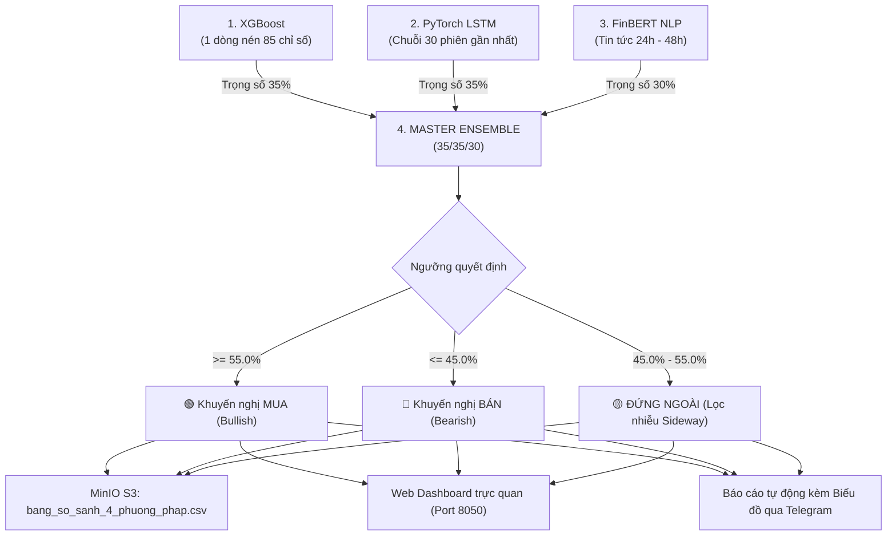

# 📊 BÁO CÁO TỔNG KẾT KIẾN TRÚC DỮ LIỆU & CƠ CHẾ DỰ BÁO
**Dự án: Quantum Multi-Modal Stock Forecasting & MLOps Platform**

---

## 1. TỔNG QUAN DỮ LIỆU ĐẦU VÀO (DATA INGESTION)

* **Phạm vi đối tượng**: **20 cổ phiếu Blue-chip Mỹ (S&P 500)** trải rộng qua 8 nhóm ngành (chuẩn GICS):
  * *Công nghệ*: `AAPL`, `MSFT`, `NVDA`, `GOOGL`
  * *Hàng tiêu dùng không thiết yếu*: `AMZN`, `MCD`, `NKE`
  * *Hàng tiêu dùng thiết yếu*: `WMT`, `PG`, `KO`
  * *Tài chính - Ngân hàng*: `JPM`, `V`
  * *Y tế - Dược phẩm*: `UNH`, `JNJ`
  * *Công nghiệp*: `CAT`, `BA`
  * *Năng lượng*: `XOM`, `CVX`
  * *Tiện ích & Vật liệu*: `NEE`, `LIN`
* **Nguồn dữ liệu**:
  * **Thị trường & Tài chính cơ bản**: Yahoo Finance API (qua `yfinance`).
  * **Liên thị trường & Vĩ mô**: `SPY` (S&P 500), `QQQ` (Nasdaq), `^VIX` (đo nỗi sợ), `^TNX` (lợi suất trái phiếu 10Y), `GC=F` (Vàng), `CL=F` (Dầu WTI), `DX-Y.NYB` (USD Index), `HYG` (khẩu vị tín dụng rủi ro cao).
  * **Tin tức tài chính**: Đa nguồn RSS thời gian thực (Yahoo Finance RSS, Google News RSS, CNBC RSS).
* **Thời gian lịch sử cào về**: **5 năm** (`period="5y"` – đã được tối ưu tinh gọn từ 15 năm).

---

## 2. PHÂN ĐỊNH RÕ RÀNG: HUẤN LUYỆN (TRAIN) VS DỰ BÁO (INFERENCE)

Hệ thống phân định chặt chẽ giữa 2 giai đoạn:

```
[--- VÙNG ĐỆM: 1 NĂM ---][--- TRAIN: 3 NĂM ---][--- VAL: 3 THÁNG ---][--- TEST: 6 THÁNG ---] ──► [DỰ BÁO NGÀY MAI]
   Khởi tạo MA200, 52w      Cho mô hình học         Cân chỉnh tham số     Sát hạch chất lượng        1 dòng / 30 phiên
   (Loại bỏ vì có NaN)       quy luật quá khứ       Optuna / EarlyStop     Champion Gate (AUC/Acc)    chốt tín hiệu MUA/BÁN
```

| Giai đoạn | Thời lượng sử dụng | Mục đích chính |
| :--- | :--- | :--- |
| **Warm-up Window** | ~1 năm đầu (được drop bỏ) | Làm "vùng đệm" toán học để tính MA 200 ngày (`ret_close_sma200`) và Đỉnh/Đáy 52 tuần (`dist_52w_high`). |
| **Train Set** | **3 năm gần nhất** | Cung cấp hàng ngàn mẫu dữ liệu quá khứ cho XGBoost và LSTM học quy luật giá (kèm trọng số thời gian Recency Weights). |
| **Validation Set** | **63 phiên (~3 tháng)** | Cân chỉnh siêu tham số tự động qua Optuna Bayesian và điểm dừng sớm (Early Stopping). |
| **Test Set** | **126 phiên (~6 tháng)** | **Cực kỳ quan trọng**: Sát hạch độc lập xem mô hình có đạt $Accuracy \ge 48\%$ và $AUC \ge 0.45$ hay không. Nếu không đạt $\rightarrow$ bật **SAFE MODE / FALLBACK** để tránh rủi ro. |
| **Inference (Dự báo)** | **Hôm nay (1 phiên / 30 phiên / 24-48h)** | Đưa dữ liệu thị trường mới nhất vào mô hình đã vượt qua bài thi để xuất tín hiệu cho phiên tiếp theo. |

---

## 3. BẢN CHẤT TẬP DATA DỰ BÁO CỦA TỪNG MÔ HÌNH

Hàng ngày vào lúc **22:00 UTC (05:00 sáng VN)** sau khi sàn Mỹ đóng cửa, 3 mô hình nhận dữ liệu để suy luận độc lập:

| Tiêu chí | Mô hình 1: **XGBoost** | Mô hình 2: **PyTorch LSTM** | Mô hình 3: **FinBERT** |
| :--- | :--- | :--- | :--- |
| **Bản chất data** | **1 Bảng tổng kết số liệu hôm nay** | **1 Đoạn video quay lại 30 ngày qua** | **Các bài báo nóng hôm nay & hôm qua** |
| **Cấu trúc & Kích thước** | Ma trận 2D: **`(20, 85)`**<br>• 20 hàng (20 mã cổ phiếu)<br>• 85 cột (85 chỉ số kỹ thuật/vĩ mô) | Tensor 3D: **`(20, 30, 25)`**<br>• 20 mã cổ phiếu<br>• 30 phiên liên tục (Lookback=30)<br>• 25 chỉ số chuỗi nến/động lượng | Dạng văn bản: **`(N_bài, 128 tokens)`**<br>• Tiêu đề (Headline) + Tóm tắt (Summary)<br>• Thu thập trong 24h – 48h gần nhất |
| **Cách nạp vào** | Nạp **đúng 1 dòng duy nhất** của ngày hôm nay cho mỗi mã. Dòng này đã nén sẵn MA200, RSI, biến động 20 ngày, lợi nhuận 5 ngày qua (`lag1-lag5`), P/E, ROE. | Nạp **cả khối 30 cây nến liên tiếp** để mạng nơ-ron tuần hoàn phân tích xu hướng và hành vi sóng. | Nạp các câu văn tiếng Anh vào mô hình ngôn ngữ Transformer để phân tích ngữ nghĩa. |
| **Đầu ra suy luận** | • Xác suất tăng giá $T+1$<br>• Giá mục tiêu 5 ngày tới ($T+5$) | • Xác suất tăng giá $T+1$ theo chuỗi thời gian | • Điểm cảm xúc tin tức quy đổi:<br>$\text{Score} = \frac{1 + \text{Pos} - \text{Neg}}{2}$ |

---

## 4. QUY TRÌNH MASTER ENSEMBLE & ĐẦU RA HỆ THỐNG

Sau khi có kết quả từ 3 phương pháp độc lập, DAG `dag_ensemble_master` thực hiện tổng hợp:

$$\text{Xác suất Ensemble} = 35\% \times P_{\text{XGBoost}} + 35\% \times P_{\text{LSTM}} + 30\% \times \text{Score}_{\text{FinBERT}}$$



---

## 5. ĐÁNH GIÁ TÍNH TỐI ƯU CỦA HỆ THỐNG

### 🎯 Điểm mạnh (Rất tối ưu):
1. **Dùng đúng sở trường thuật toán**: XGBoost xử lý dữ liệu bảng tĩnh và tương quan đa biến; LSTM bắt mẫu hình sóng động lượng; FinBERT bắt sự kiện tin tức giật gân.
2. **Tốc độ suy luận siêu tốc**: XGBoost và LSTM chỉ mất vài mili-giây trên CPU để dự báo, không ngốn tài nguyên máy chủ.
3. **An toàn MLOps (Champion Gate)**: Không bao giờ tin tưởng mù quáng vào mô hình, luôn có bài kiểm tra 6 tháng độc lập và tự động fallback về Safe Mode nếu phát hiện mô hình đoán mò.
4. **Đã tinh gọn 5 năm**: Giảm được 60% thời gian cào và lưu trữ so với 15 năm ban đầu, vừa vặn hoàn hảo cho các chu kỳ kỹ thuật.

### 💡 Điểm có thể nâng cấp trong tương lai:
1. **Trọng số động (Dynamic Weighting)**: Điều chỉnh tỷ trọng FinBERT linh hoạt tùy theo số lượng bài báo trong ngày (ngày nhiều tin quan trọng thì tăng tỷ trọng, ngày ít tin thì giảm).
2. **Mở rộng độ trễ (Lags)**: Bổ sung thêm `lag1` đến `lag10` cho khối lượng (Volume) và RSI để dòng dữ liệu của XGBoost phản ánh thêm chi tiết vi mô của 2 tuần gần nhất.
